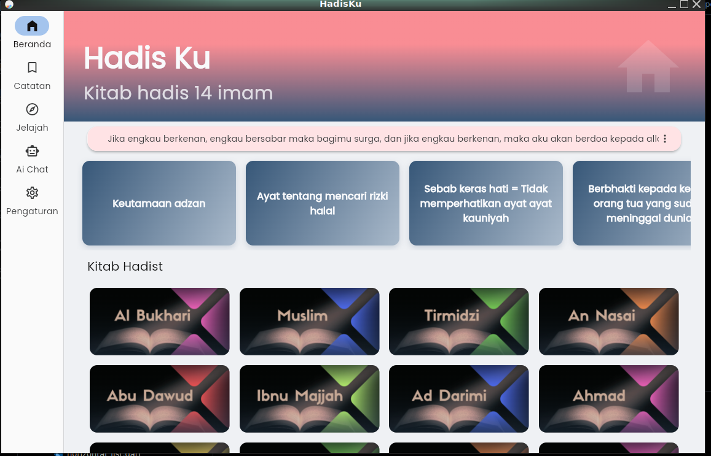
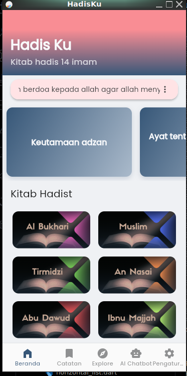

# HadisKu – Kitab Hadis 14 Imam

**HadisKu** adalah aplikasi multi-platform yang menyatukan koleksi otentik dari **14 Imam** dalam satu tempat, sehingga memudahkan Anda mempelajari, merujuk, dan berbagi hadis di mana pun Anda berada.

## 🌟 Selamat Datang di HadisKu

**HadisKu** dirancang untuk membantu umat Islam memperdalam pengetahuan dan pemahaman mereka tentang hadis, dengan menghadirkan perpustakaan digital yang kaya, ringan, dan mudah diakses berisi karya-karya dari **14 Imam** terkemuka.

Baik untuk belajar, mengajar, maupun refleksi pribadi, **HadisKu** hadir sebagai teman Anda dalam menjelajahi hadis-hadis autentik.

---

## 🕊️ HadisKu 4.0 — Tanpa Iklan, Tanpa Akun, Tanpa Tracking

Sejak **versi 3.0.0**, dan kini dipertegas di **versi 4.0**, HadisKu hadir tanpa:

- **Iklan**
- **Pembelian dalam aplikasi (IAP)**
- **Langganan**
- **Akun pengguna** — tidak perlu mendaftar, tidak perlu login
- **Pelacakan data pribadi** — tidak ada analytics yang mengidentifikasi Anda

HadisKu kembali menjadi aplikasi yang lebih tenang, lebih bersih, dan lebih nyaman untuk belajar hadis — dengan fokus pada manfaat, kemudahan, dan privasi pengguna.

> Perubahan ini bukan sekadar update fitur, tapi bagian dari mengembalikan HadisKu ke niat awalnya.

📖 **Baca cerita lengkap dari pembuat HadisKu:**  
[blog.cahyanudien.site/aplikasi-hadisku-sekarang-tanpa-iklan](https://blog.cahyanudien.site/aplikasi-hadisku-sekarang-tanpa-iklan)

---

## 🚀 HadisKu 4.0 — Dibangun Ulang dari Nol

Versi 4.0 adalah penulisan ulang total dari aplikasi HadisKu. Dari Flutter ke **Native Kotlin (Jetpack Compose)**. Bukan sekadar porting — seluruh arsitektur, tampilan, dan pengalaman pengguna dirancang kembali.

**Yang berubah:**

- ⚡ **Lebih cepat** — mesin native yang responsif, tanpa lapisan framework tambahan
- 📦 **Lebih ringan** — ukuran APK lebih kecil, konsumsi memori lebih efisien
- 🎨 **Antarmuka baru** — desain Material 3 yang lebih rapi dan modern
- 🛠️ **Lebih stabil** — arsitektur MVVM yang bersih, mudah dikembangkan ke depan
- 📖 **Pengalaman membaca baru** — kontrol tipografi dan tata letak yang lebih lengkap

📖 **Baca cerita lengkap dari pembuat HadisKu:**  
[blog.cahyanudien.site/membangun-ulang-hadisku-40-tiga-bulan-untuk-memulai-kembali](https://blog.cahyanudien.site/membangun-ulang-hadisku-40-tiga-bulan-untuk-memulai-kembali)

---

## 📚 Koleksi Hadis dari 14 Imam

HadisKu menghadirkan kumpulan hadis dari para imam dan kitab-kitab utama, di antaranya:

- Hadits Imam Bukhari
- Hadits Imam Muslim
- Hadits Sunan Tirmidzi
- Hadits Sunan An Nasai
- Hadits Sunan Abu Dawud
- Hadits Sunan Ibnu Majjah
- Hadits Sunan Ad Darimi
- Hadits Musnad Ahmad
- Hadits Muwatha Malik
- Hadits Sunan Daruquthni
- Hadits Shahih Ibnu Khuzaimah
- Hadits Shahih Ibnu Hibban
- Hadits Al Mustadrak
- Hadits Musnad Syafii

Setiap hadis dilengkapi:

- **Teks Arab asli**
- **Terjemahan Indonesia**
- **Status keaslian sanad** (shahih, hasan, dhaif)
- **Informasi perawi**

---

## 📱 Unduh HadisKu

HadisKu tersedia di berbagai platform utama:

| Platform       | Unduh                                                                             | Persyaratan   |
| -------------- | --------------------------------------------------------------------------------- | ------------- |
| 🖥️ **Windows** | [Unduh](https://flagodna-developer.github.io/hadisku/download/windows)            | Windows 10+   |
| 🍎 **macOS**   | Dalam proses                                                                      | macOS 10.15+  |
| 🐧 **Linux**   | [Unduh](https://flagodna-developer.github.io/hadisku/download/linux)              | Ubuntu 18.04+ |
| 📱 **Android** | [Google Play](https://play.google.com/store/apps/details?id=com.flagodna.hadisku) | Android 6.0+  |
| 🍎 **iOS**     | Dalam proses                                                                      | iOS 12.0+     |

> Saat ini HadisKu sudah tersedia untuk **Android**, dan dukungan untuk platform lain terus disiapkan secara bertahap.

---

## ✨ Mengapa Anda Akan Menyukainya

### 🔍 Pencarian Lintas Imam

Cari hadis dari seluruh **14 kitab sekaligus** dalam satu pencarian. Ketik kata kunci seperti "sabar" atau "shalat malam", dan hasil muncul dari semua imam. Bisa juga mencari berdasarkan nomor hadis, atau memfilter beberapa imam sekaligus.

### 📖 Lanjutkan Membaca

Aplikasi mengingat hadis terakhir yang kamu buka. Cukup ketuk kartu "Lanjutkan Membaca" di halaman utama, dan kamu langsung kembali ke tempat terakhir.

### 🌅 Hadis Pilihan & Bacaan Harian

Sorotan hadis pilihan setiap hari, plus bacaan harian islami untuk menemani rutinitas ibadahmu. Konten diperbarui dari server dan tetap tersedia saat offline.

### 🧭 Jelajah Berdasarkan Tema

Bingung mulai dari mana? Jelajahi hadis sesuai topik — thaharah, shalat, puasa, zakat, haji, dan seterusnya. Setiap kategori berisi daftar tema yang lebih spesifik, lengkap dengan jumlah hadis per topik.

### 🔖 Simpan Hadis untuk Dibaca Nanti

Tandai hadis penting agar mudah ditemukan kembali. Tersimpan secara lokal, tetap rapi meskipun koleksinya sudah ratusan, dan tetap tersedia saat offline.

### 🎨 Pembuat Kartu Hadis

Ubah hadis favorit menjadi gambar rapi yang siap dibagikan ke media sosial. Tersedia 20 pilihan gradien dan 30 latar, atau gunakan foto dari galeri perangkatmu sendiri.

### 📝 Catatan Pribadi

Tulis pelajaran dan refleksi pada catatan pribadimu. Sisipkan referensi hadis langsung dengan format `@bukhari:6018` — saat diketuk, hadis akan terbuka. Cocok untuk menyusun daftar hadis pilihan berdasarkan tema tertentu.

### 👤 Biografi Imam Hadis

Kenali latar belakang para imam hadis: kapan hidupnya, di mana mengajar, dan bagaimana kitabnya disusun. Karena belajar hadis tanpa mengenal perawinya terasa kering.

### 🎓 Ilmu Dasar Hadis — 38 Istilah

Pintu masuk bagi pemula: 38 istilah penting dalam ilmu hadis dijelaskan dengan bahasa sederhana — sanad, matan, mutawatir, ahad, shahih, hasan, dhaif, marfu', mauquf, maqthu', dan seterusnya.

### ⚙️ Tampilan yang Bisa Diatur

- Mode gelap & terang
- Ukuran teks Arab dan terjemahan bisa diatur **terpisah**
- Perataan teks (kiri, kanan, atau rata tengah)
- Urutan tampilan: Arab dulu atau terjemahan dulu
- Tata letak kartu hadis: vertikal atau kotak

### 🌙 Akses Offline

Belajar tanpa internet — bawa seluruh perpustakaan hadis Anda ke mana pun Anda pergi. Setelah instalasi pertama, seluruh koleksi tersedia tanpa memerlukan koneksi.

### 🔄 Pembaruan & Ulasan Dalam Aplikasi

Perbarui HadisKu langsung dari dalam aplikasi tanpa perlu membuka Play Store. Begitu juga dengan permintaan ulasan — muncul pada momen yang tepat, tidak mengganggu saat membaca.

---

## 🆘 Roadmap

Rencana pengembangan aplikasi **HadisKu** ke depan.

### ✅ v4.0.1 — Perbaikan (10 November 2026)

- [x] **Perbaikan data dari server**  
       Konten dari server (hadis pilihan harian, jelajah tema, modal, info footer) kini tampil normal di semua perangkat.

- [x] **Optimasi ukuran & performa**  
       Penyempurnaan konfigurasi build untuk memastikan aplikasi stabil di versi rilis.

### ✅ v4.0.0 — Rilis Publik (7 November 2026)

Penulisan ulang total dari Flutter ke **Native Kotlin (Jetpack Compose)**.

- [x] **Arsitektur baru** — MVVM + Hilt + Coroutines + Flow
- [x] **Antarmuka Material 3** — desain ulang menyeluruh
- [x] **Pencarian lintas imam** — cari dari 14 kitab sekaligus, filter multi-imam
- [x] **Lanjutkan membaca** — ingat hadis terakhir yang dibuka
- [x] **Hadis pilihan & bacaan harian** — konten dari server, tetap tersedia offline
- [x] **Jelajah berdasarkan tema** — hadis dikelompokkan berdasarkan topik
- [x] **Simpan hadis** — tandai hadis untuk dibaca nanti
- [x] **Pembuat kartu hadis** — 20 gradien + 30 latar + galeri lokal
- [x] **Catatan pribadi** — dengan referensi hadis inline (`@bukhari:6018`)
- [x] **Biografi imam** — latar belakang para perawi
- [x] **Ilmu dasar hadis** — 38 istilah penting
- [x] **Pengaturan tampilan lengkap** — dark/light, ukuran teks, alignment, order, card layout
- [x] **Pembaruan & ulasan dalam aplikasi**
- [x] **Tanpa akun, tanpa iklan, tanpa IAP, tanpa tracking**

### ✅ v3.0.0 — Pembaruan Besar

- [x] **Pembaruan ikon aplikasi**  
       Mengganti ikon lama dengan ikon baru yang lebih fresh dan representatif.

  | Sebelum                                | Sesudah                                |
  | -------------------------------------- | -------------------------------------- |
  |  |  |

- [x] **Menghapus iklan di aplikasi**  
       Pengalaman menggunakan HadisKu kini lebih nyaman tanpa iklan.  
       _Terima kasih untuk saran dari: [Gathut Bintoro](https://github.com/Flagodna-Developer/hadisku/issues/4), [Herfando](https://github.com/Flagodna-Developer/hadisku/issues/5)_

- [x] **Pencarian teks Arab & pengaturan urutan detail hadis**  
       Menambahkan fitur pencarian hadis berdasarkan teks Arab, serta opsi tampilan:

  - Arab → Indonesia
  - Indonesia → Arab  
    _Terima kasih untuk saran dari: [Sopandi Akbar](https://github.com/Flagodna-Developer/hadisku/issues/7)_

- [x] **Pengaturan perataan teks Arab**  
       Menambahkan opsi perataan teks Arab: rata kiri, rata kanan, justify.

- [x] **Menghapus IAP & langganan**  
       Fitur pembelian dalam aplikasi dan langganan telah dihapus.  
       Dukungan pengembangan kini dapat dilakukan secara sukarela melalui donasi:  
       **https://dukung.flagodna.com**

- [x] **Rilis Android (v3.0.0)**

- [x] **Rilis Windows (v3.0.0)**

- [x] **Rilis Linux (v3.0.0)**

### ✅ v2.5.1 — Versi Sebelumnya

- [x] **Pembuat Kartu Hadis**  
       Ubah hadis favorit menjadi kartu gambar yang indah dan siap dibagikan ke media sosial.

- [x] **Pencarian lebih cepat dan akurat**  
       Cari hadis berdasarkan teks maupun nomor kini lebih cepat, lebih ringan, dan lebih presisi.

- [x] **Optimasi performa aplikasi**  
       Berbagai peningkatan sistem agar aplikasi terasa lebih ringan, responsif, dan nyaman digunakan.

---

## ❤️ Misi Kami

- 🕌 **Menyebarkan pengetahuan Islam kepada setiap Muslim dengan penuh perhatian dan keaslian.**
- 📖 **Membuat studi hadis menjadi mudah, terjangkau, dan menyenangkan.**
- 🤝 **Mendukung pembelajaran seumur hidup dalam umat Islam.**

---

## 🚀 Memulai

1. **Unduh** aplikasi untuk platform Anda dari tabel di atas.
2. **Instal** aplikasi tersebut mengikuti proses instalasi standar sistem Anda.
3. **Buka** HadisKu — tidak perlu mendaftar atau login.
4. **Jelajahi** fitur-fiturnya dan sesuaikan dengan preferensi Anda.

---

## 📸 Screenshots

---

## 🔗 Jelajahi Lebih Lanjut

| Link                                                                                                                               | Deskripsi                                 |
| ---------------------------------------------------------------------------------------------------------------------------------- | ----------------------------------------- |
| [⭐ Berikan Rating Aplikasi](https://play.google.com/store/apps/details?id=com.flagodna.hadisku)                                   | Umpan balik Anda membantu kami berkembang |
| [🕊️ Cerita di Balik HadisKu Tanpa Iklan](https://blog.cahyanudien.site/aplikasi-hadisku-sekarang-tanpa-iklan)                      | Kenapa HadisKu kini kembali tanpa iklan   |
| [🚀 Cerita Membangun Ulang HadisKu 4.0](https://blog.cahyanudien.site/membangun-ulang-hadisku-40-tiga-bulan-untuk-memulai-kembali) | Tiga bulan untuk memulai kembali          |
| [🌐 Situs Web Resmi](https://flagodna-developer.github.io/hadisku/)                                                                | Temukan lebih banyak tentang visi kami    |
| [💻 Proyek GitHub](https://github.com/Flagodna-Developer/hadisku)                                                                  | Lihat bagaimana aplikasi ini dibangun     |
| [🤝 Berkontribusi](https://github.com/Flagodna-Developer/hadisku/blob/main/CONTRIBUTING.md)                                        | Bantu tingkatkan HadisKu                  |
| [📱 Unduh di Perangkat Lain](https://flagodna-developer.github.io/hadisku/download/)                                               | Tersedia di mana pun Anda membutuhkannya  |
| [❤️ Dukung Pengembangan](https://dukung.flagodna.com)                                                                              | Bantu HadisKu tetap berkembang untuk umat |

---

## 🙌 Di Balik HadisKu

|  **[Cahyanudien AS](https://github.com/cas8398)** |
| :---------------------------------------------------------------------------------------------------------------: |
|                                           ✨ Pencipta & Pengelola Utama                                           |

HadisKu dibangun dan dikelola secara independen sebagai bagian dari semangat menghadirkan teknologi yang bermanfaat, ringan, dan lebih selaras dengan nilai-nilai Islam.

---

## 🆘 Dukungan & Masukan

Butuh bantuan, menemukan bug, atau ingin berbagi masukan?

- 📧 **Email**: flagodna.com@gmail.com
- 🐛 **Laporan Bug**: [GitHub Issues](https://github.com/Flagodna-Developer/hadisku/issues)
- 📝 **Form Saran & Masukan**: [Google Form](https://forms.gle/5Spwijiwb4u8mBbK6)

---

## 🙏 Ucapan Terima Kasih

Terima kasih khusus kepada semua pengguna yang telah memberikan umpan balik, saran, doa, dan dukungan sehingga **HadisKu** terus berkembang menjadi lebih baik untuk seluruh umat Muslim.

---

**Dibuat dengan ❤️ untuk Umat Muslim**

_“Barangsiapa yang menempuh jalan untuk mencari ilmu, Allah akan memudahkan baginya jalan menuju surga.” — Nabi Muhammad ﷺ (HR. Muslim)_
