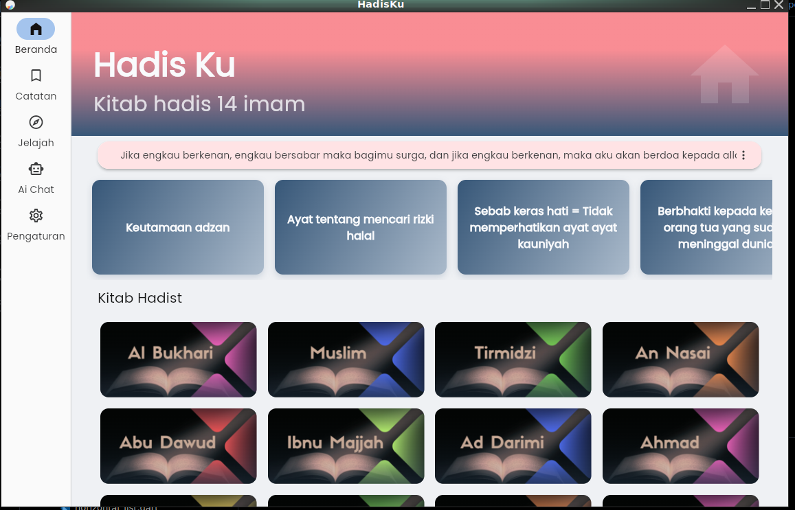
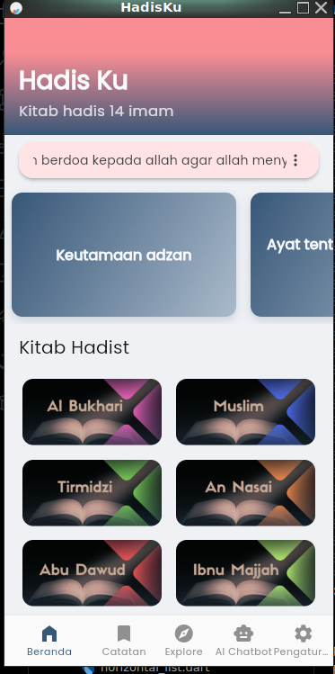

# HadisKu – Kitab Hadis 14 Imam

**HadisKu** adalah aplikasi multi-platform yang menyatukan koleksi hadis dari **14 Imam** dalam satu tempat, sehingga memudahkan Anda mempelajari, mencari, merujuk, dan berbagi hadis di mana pun Anda berada.

---

## 🌟 Selamat Datang di HadisKu

**HadisKu** dirancang untuk membantu umat Islam memperdalam pengetahuan dan pemahaman tentang hadis melalui perpustakaan digital yang kaya, ringan, dan mudah diakses. HadisKu menghadirkan koleksi dari **14 Imam** dengan sekitar **74.000 hadis** dalam satu aplikasi.

Baik untuk belajar, mengajar, mencari referensi, maupun refleksi pribadi, **HadisKu** hadir sebagai teman Anda dalam menjelajahi hadis.

---

## 🕊️ HadisKu 4.0 — Tanpa Iklan, Tanpa Akun, Tanpa Tracking

Sejak **versi 3.0.0**, dan kini dipertegas di **versi 4.0**, HadisKu hadir tanpa:

- **Iklan**
- **Pembelian dalam aplikasi (IAP)**
- **Langganan**
- **Akun pengguna** — tidak perlu mendaftar atau login
- **Pelacakan data pribadi** — tidak ada analytics yang mengidentifikasi Anda

HadisKu ingin menjadi aplikasi yang lebih tenang, lebih bersih, dan lebih nyaman untuk belajar hadis — dengan fokus pada manfaat, kemudahan, dan privasi pengguna.

> Perubahan ini bukan sekadar update fitur, tetapi bagian dari mengembalikan HadisKu ke niat awalnya.

📖 **Baca cerita lengkap dari pembuat HadisKu:**

[blog.cahyanudien.site/aplikasi-hadisku-sekarang-tanpa-iklan](https://blog.cahyanudien.site/aplikasi-hadisku-sekarang-tanpa-iklan)

---

## 🚀 HadisKu 4.0 — Dibangun Ulang dari Nol

Versi 4.0 adalah penulisan ulang total dari aplikasi HadisKu. Dari Flutter ke **Native Kotlin (Jetpack Compose)**. Bukan sekadar porting — arsitektur, tampilan, dan pengalaman pengguna dirancang kembali.

**Yang berubah:**

- ⚡ **Lebih cepat** — menggunakan teknologi native Android untuk pengalaman yang lebih responsif.
- 📦 **Lebih ringan** — optimasi ukuran aplikasi dan penggunaan memori.
- 🎨 **Antarmuka baru** — desain ulang menggunakan Material 3.
- 🛠️ **Arsitektur baru** — MVVM, Hilt, Coroutines, dan Flow.
- 📖 **Pengalaman membaca baru** — pengaturan tipografi dan tata letak yang lebih lengkap.

📖 **Baca cerita lengkap dari pembuat HadisKu:**

[Membangun Ulang HadisKu 4.0 — Tiga Bulan untuk Memulai Kembali](https://blog.cahyanudien.site/membangun-ulang-hadisku-40-tiga-bulan-untuk-memulai-kembali)

### Masih ingin menggunakan HadisKu versi 3?

Kami tetap menyediakan **HadisKu versi 3.0.0** bagi pengguna yang lebih nyaman dengan tampilan dan pengalaman versi sebelumnya. Anda dapat mengunduh APK dan membaca informasi pemasangannya melalui halaman berikut:

- 📱 [HadisKu Versi 3 — Unduh APK dan informasi](https://hadisku.id/versi-3/)
- 🌐 [HadisKu Version 3 — English](https://hadisku.id/en/version-3/)

Pengembangan HadisKu saat ini berlanjut pada versi 4. Pengguna yang ingin memakai versi terbaru dapat mengunduhnya melalui [Google Play](https://play.google.com/store/apps/details?id=com.flagodna.hadisku).

---

## 📚 Koleksi Hadis dari 14 Imam

HadisKu menghadirkan kumpulan hadis dari para imam dan kitab-kitab utama, di antaranya:

- Hadis Imam Bukhari
- Hadis Imam Muslim
- Hadis Sunan Tirmidzi
- Hadis Sunan An-Nasai
- Hadis Sunan Abu Dawud
- Hadis Sunan Ibnu Majah
- Hadis Sunan Ad-Darimi
- Hadis Musnad Ahmad
- Hadis Muwatha Malik
- Hadis Sunan Daruquthni
- Hadis Shahih Ibnu Khuzaimah
- Hadis Shahih Ibnu Hibban
- Hadis Al-Mustadrak
- Hadis Musnad Syafii

Setiap hadis dilengkapi dengan informasi yang tersedia, antara lain:

- **Teks Arab asli**
- **Terjemahan Indonesia**
- **Status hadis** (shahih, hasan, dhaif)
- **Informasi perawi**

---

## 📱 Unduh HadisKu

HadisKu dikembangkan sebagai aplikasi **multi-platform**. Pilih platform yang sesuai dengan perangkat Anda:

| Platform       | Unduh                                                                                          | Persyaratan   |
| -------------- | ---------------------------------------------------------------------------------------------- | ------------- |
| 🖥️ **Windows** | [Unduh](https://flagodna-developer.github.io/hadisku/download/windows)                         | Windows 10+   |
| 🍎 **macOS**   | Dalam proses                                                                                   | macOS 10.15+  |
| 🐧 **Linux**   | [Unduh](https://flagodna-developer.github.io/hadisku/download/linux)                           | Ubuntu 18.04+ |
| 📱 **Android** | [Google Play — HadisKu v4](https://play.google.com/store/apps/details?id=com.flagodna.hadisku) | Android 6.0+  |
| 🍎 **iOS**     | Dalam proses                                                                                   | iOS 12.0+     |

> HadisKu tersedia untuk Android, Windows, dan Linux. Dukungan macOS dan iOS masih disiapkan secara bertahap. Untuk pengguna Android yang ingin memakai versi sebelumnya, APK HadisKu v3.0.0 juga tersedia melalui [halaman versi 3](https://hadisku.id/versi-3/).

---

## ✨ Mengapa Anda Akan Menyukainya

### 🔍 Pencarian Lintas Imam

Cari hadis dari seluruh **14 kitab sekaligus** dalam satu pencarian. Ketik kata kunci seperti "sabar" atau "shalat malam", dan hasil akan muncul dari berbagai imam. Anda juga dapat mencari berdasarkan nomor hadis atau memfilter imam yang ingin ditampilkan.

### 📖 Lanjutkan Membaca

Aplikasi mengingat hadis terakhir yang Anda buka. Cukup ketuk kartu **Lanjutkan Membaca** di halaman utama untuk kembali ke bacaan terakhir.

### 🌅 Hadis Pilihan & Bacaan Harian

Temukan hadis pilihan dan bacaan harian Islami untuk menemani rutinitas ibadah. Konten diperbarui dari server dan dapat tetap diakses saat offline setelah tersedia di perangkat.

### 🧭 Jelajah Berdasarkan Tema

Bingung mulai dari mana? Jelajahi hadis sesuai topik — thaharah, shalat, puasa, zakat, haji, dan seterusnya. Setiap kategori berisi daftar tema yang lebih spesifik, lengkap dengan jumlah hadis per topik.

### 🔖 Simpan Hadis untuk Dibaca Nanti

Tandai hadis penting agar mudah ditemukan kembali. Hadis tersimpan secara lokal, tetap rapi meskipun koleksinya sudah banyak, dan dapat diakses tanpa internet.

### 🎨 Pembuat Kartu Hadis

Ubah hadis favorit menjadi gambar yang siap dibagikan ke media sosial. Tersedia **20 pilihan gradien** dan **30 latar**, atau gunakan foto dari galeri perangkat Anda sendiri.

### 📝 Catatan Pribadi

Tulis pelajaran dan refleksi pada catatan pribadi. Sisipkan referensi hadis langsung dengan format `@bukhari:6018` — saat diketuk, hadis akan terbuka. Cocok untuk menyusun kumpulan hadis berdasarkan tema tertentu.

### 👤 Biografi Imam Hadis

Kenali latar belakang para imam hadis: perjalanan hidup, tempat belajar dan mengajar, serta kitab yang mereka susun. HadisKu menyediakan **10 biografi imam** yang dapat dibaca di dalam aplikasi.

### 🎓 Ilmu Dasar Hadis — 38 Istilah

Pintu masuk bagi pemula: **38 istilah penting** dalam ilmu hadis dijelaskan dengan bahasa sederhana — sanad, matan, mutawatir, ahad, shahih, hasan, dhaif, marfu', mauquf, maqthu', dan seterusnya.

### ⚙️ Tampilan yang Bisa Diatur

- Mode gelap dan terang.
- Ukuran teks Arab dan terjemahan dapat diatur **secara terpisah**.
- Perataan teks Arab: kiri, kanan, atau justify.
- Urutan tampilan: Arab terlebih dahulu atau terjemahan terlebih dahulu.
- Tata letak kartu hadis: vertikal atau kotak.

### 🌙 Akses Offline

Belajar tanpa internet — bawa koleksi hadis ke mana pun Anda pergi. Setelah data koleksi tersedia di perangkat, hadis dapat dibaca tanpa koneksi internet. Konten tertentu yang diperbarui dari server memerlukan koneksi untuk mengambil pembaruan.

### 🔄 Pembaruan & Ulasan Dalam Aplikasi

Periksa pembaruan HadisKu dan berikan ulasan langsung melalui aplikasi. Permintaan ulasan ditampilkan pada momen yang sesuai agar tidak mengganggu saat membaca.

### 🤖 Tentang HadisKu AI

HadisKu AI tidak disertakan dalam versi 4. Kami menghapus fitur tersebut setelah menyadari bahwa integrasinya belum menyeluruh dan masih memiliki keterbatasan dalam memberikan jawaban yang tepat. HadisKu AI versi stabil mungkin akan dikembangkan kembali pada masa mendatang, tetapi saat ini belum ada jadwal rilis.

---

## 🆕 Changelog

### ✅ v4.0.3 — Perbaikan & Pencarian Arab

📅 **12 November 2026**

- 🔎 **Pencarian Arab, Font Arab & Render RTL** — menambahkan dukungan pencarian teks Arab, pilihan font Arab, dan render RTL (kanan ke kiri) agar tampilan teks Arab lebih nyaman.
- 🛠️ **Perbaikan Hasil Pencarian Arab** — hasil pencarian Arab kini menampilkan teks Arab yang cocok, bukan terjemahan Indonesia.
- 🔠 **Ukuran Teks Arab di Kartu Hadis** — ukuran teks Arab pada kartu mengikuti pengaturan `arabicTextSize` secara terpisah.
- 📖 **Perbaikan Data Hadis** — memperbaiki data hadis Ad-Darimi nomor 2664 dan Bukhari nomor 26.
- 🏷️ **Label Ikon Aksi** — menambahkan label di bawah ikon aksi pada bilah atas daftar hadis (Cari, Tema).
- 🔐 **Perbaikan Layanan Kunci Lokal** — memperbaiki layanan kunci lokal agar penyimpanan dan akses data berjalan lebih stabil.

### ✅ v4.0.2 — Perbaikan

📅 **11 November 2026**

- 📚 **Tambah Kitab di Halaman Daftar Hadis** — memperbaiki penambahan kitab pada halaman daftar hadis.

### ✅ v4.0.1 — Perbaikan

📅 **10 November 2026**

- 🛠️ **Perbaikan Data dari Server** — memperbaiki konten hadis pilihan harian, jelajah tema, modal, dan informasi footer yang tidak muncul di sebagian perangkat setelah pembaruan ke v4.0.0. Termasuk perbaikan respons API yang gagal akibat konfigurasi ProGuard.
- 📦 **Optimasi Ukuran & Performa** — menyempurnakan konfigurasi build agar aplikasi berjalan lebih stabil pada versi rilis.

### ✅ v4.0.0 — Rilis Publik

📅 **7 November 2026**

Penulisan ulang total dari Flutter ke **Native Kotlin (Jetpack Compose)**.

- 🏗️ **Arsitektur baru** — MVVM + Hilt + Coroutines + Flow.
- 🎨 **Antarmuka Material 3** — desain ulang menyeluruh.
- 🔍 **Pencarian lintas imam** — mencari dari 14 kitab sekaligus dan memfilter beberapa imam.
- 📖 **Lanjutkan Membaca** — mengingat hadis terakhir yang dibuka.
- 🌅 **Hadis pilihan & bacaan harian** — konten dari server dan dapat tersedia offline.
- 🧭 **Jelajah berdasarkan tema** — hadis dikelompokkan berdasarkan topik.
- 🔖 **Simpan hadis** — tandai hadis untuk dibaca nanti.
- 🎨 **Pembuat kartu hadis** — 20 gradien, 30 latar, dan galeri lokal.
- 📝 **Catatan pribadi** — dengan referensi hadis inline (`@bukhari:6018`).
- 👤 **Biografi imam** — informasi latar belakang para imam.
- 🎓 **Ilmu dasar hadis** — 38 istilah penting.
- ⚙️ **Pengaturan tampilan** — mode gelap/terang, ukuran teks, perataan, urutan teks, dan tata letak kartu.
- 🔄 **Pembaruan & ulasan dalam aplikasi**.
- 🕊️ **Tanpa akun, tanpa iklan, tanpa IAP, dan tanpa langganan**.

### ✅ v3.0.0 — Pembaruan Besar

📅 **3 April 2026**

- 🎨 **Pembaruan ikon aplikasi** — mengganti ikon lama dengan ikon baru yang lebih segar dan representatif.

  | Sebelum                                | Sesudah                                |
  | -------------------------------------- | -------------------------------------- |
  |  |  |

- 🚫 **Menghapus iklan di aplikasi** — pengalaman menggunakan HadisKu menjadi lebih nyaman tanpa iklan. Terima kasih atas saran dari [Gathut Bintoro](https://github.com/Flagodna-Developer/hadisku/issues/4) dan [Herfando](https://github.com/Flagodna-Developer/hadisku/issues/5).
- 🔎 **Pencarian teks Arab & pengaturan urutan detail hadis** — menambahkan pencarian hadis berdasarkan teks Arab, serta pilihan urutan Arab → Indonesia atau Indonesia → Arab. Terima kasih atas saran dari [Sopandi Akbar](https://github.com/Flagodna-Developer/hadisku/issues/7).
- 📝 **Pengaturan perataan teks Arab** — menambahkan pilihan rata kiri, rata kanan, dan justify.
- 🕊️ **Menghapus IAP & langganan** — dukungan pengembangan kini dapat diberikan secara sukarela melalui [donasi FlagoDNA](https://dukung.flagodna.com).
- 📱 **Rilis Android (v3.0.0)**.
- 🖥️ **Rilis Windows (v3.0.0)**.
- 🐧 **Rilis Linux (v3.0.0)**.

### ✅ v2.5.1 — Versi Sebelumnya

- 🎨 **Pembuat Kartu Hadis** — ubah hadis favorit menjadi kartu gambar yang siap dibagikan ke media sosial.
- 🔎 **Pencarian lebih cepat dan akurat** — pencarian berdasarkan teks maupun nomor hadis menjadi lebih cepat, ringan, dan presisi.
- ⚡ **Optimasi performa aplikasi** — berbagai peningkatan agar aplikasi terasa lebih ringan, responsif, dan nyaman digunakan.

---

## ❤️ Misi Kami

- 🕌 **Menyebarkan pengetahuan Islam kepada setiap Muslim dengan penuh perhatian dan keaslian.**
- 📖 **Membuat studi hadis menjadi mudah, terjangkau, dan menyenangkan.**
- 🤝 **Mendukung pembelajaran seumur hidup dalam umat Islam.**

---

## 🚀 Memulai

1. **Unduh** aplikasi untuk platform Anda melalui tautan pada bagian [Unduh HadisKu](#-unduh-hadisku).
2. **Instal** aplikasi mengikuti proses instalasi standar pada sistem Anda.
3. **Buka** HadisKu — tidak perlu mendaftar atau login.
4. **Jelajahi** koleksi hadis dan sesuaikan tampilan dengan preferensi Anda.

---

## 📸 Screenshots

### 📱 HadisKu v4

### 🖥️ HadisKu V3 Desktop

### 📱 HadisKu V3 Mobile

---

## 🔗 Jelajahi Lebih Lanjut

| Link                                                                                                                               | Deskripsi                                                    |
| ---------------------------------------------------------------------------------------------------------------------------------- | ------------------------------------------------------------ |
| [⭐ Berikan Rating Aplikasi](https://play.google.com/store/apps/details?id=com.flagodna.hadisku)                                   | Umpan balik Anda membantu kami berkembang.                   |
| [📱 HadisKu Versi 3](https://hadisku.id/versi-3/)                                                                                  | Unduh APK versi sebelumnya dan baca informasi pemasangannya. |
| [🕊️ Cerita di Balik HadisKu Tanpa Iklan](https://blog.cahyanudien.site/aplikasi-hadisku-sekarang-tanpa-iklan)                      | Mengapa HadisKu kini kembali tanpa iklan.                    |
| [🚀 Cerita Membangun Ulang HadisKu 4.0](https://blog.cahyanudien.site/membangun-ulang-hadisku-40-tiga-bulan-untuk-memulai-kembali) | Tiga bulan untuk memulai kembali.                            |
| [🌐 Situs Web Resmi](https://hadisku.id/)                                                                                          | Temukan lebih banyak tentang HadisKu.                        |
| [💻 Proyek GitHub](https://github.com/Flagodna-Developer/hadisku)                                                                  | Lihat bagaimana aplikasi ini dibangun.                       |
| [🤝 Berkontribusi](https://github.com/Flagodna-Developer/hadisku/blob/main/CONTRIBUTING.md)                                        | Bantu tingkatkan HadisKu.                                    |
| [📱 Unduh di Perangkat Lain](https://flagodna-developer.github.io/hadisku/download/)                                               | Temukan pilihan unduhan untuk platform lain.                 |
| [❤️ Dukung Pengembangan](https://dukung.flagodna.com)                                                                              | Bantu HadisKu tetap berkembang.                              |

---

## 🙌 Di Balik HadisKu

|  **[Cahyanudien AS](https://github.com/cas8398)** |
| :---------------------------------------------------------------------------------------------------------------: |
|                                           ✨ Pencipta & Pengelola Utama                                           |

HadisKu dibangun dan dikelola secara independen sebagai bagian dari semangat menghadirkan teknologi yang bermanfaat, ringan, dan lebih selaras dengan nilai-nilai Islam.

---

## 🆘 Dukungan & Masukan

Butuh bantuan, menemukan bug, atau ingin berbagi masukan?

- 📧 **Email:** [flagodna.com@gmail.com](mailto:flagodna.com@gmail.com)
- 🐛 **Laporan Bug:** [GitHub Issues](https://github.com/Flagodna-Developer/hadisku/issues)

---

## 🙏 Ucapan Terima Kasih

Terima kasih khusus kepada semua pengguna yang telah memberikan umpan balik, saran, doa, dan dukungan sehingga **HadisKu** terus berkembang menjadi lebih baik untuk seluruh umat Muslim.

---

**Dibuat dengan ❤️ untuk Umat Muslim.**

> “Barangsiapa yang menempuh jalan untuk mencari ilmu, Allah akan memudahkan baginya jalan menuju surga.” — Nabi Muhammad ﷺ (HR. Muslim)
